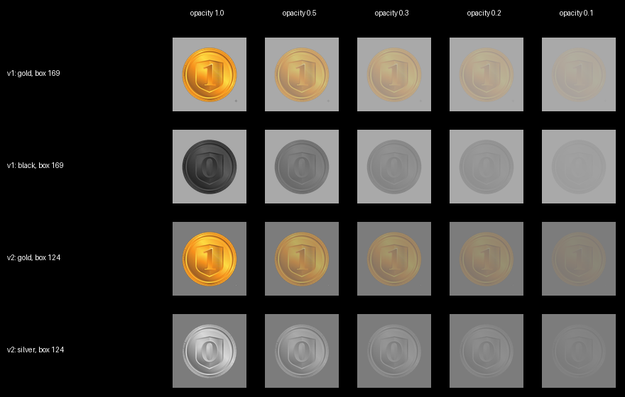

# The coin pair and the scene greys (stimulus version v2, 7 Nov 2026)

Decided by Alon on 7 Nov 2026. Analysis by Claude (Claude Code sessions, 1–7 Nov 2026),
following Liad's comment that the two coins are not equally salient. Applies to BOTH the lab
version (`config.py`) and the online pilot (`online/js/config.js`), which stay identical.

## 1. The problem

The coin is never shown on the black screen. It is shown inside the **reward box**, which was
`'darkgray'` (RGB 169) until now. How noticeable a coin is depends on how much it differs from the
surface right behind it (its *contrast*), not on its own brightness. Measured on the image files
(relative luminance of the sRGB values, coin blended over the box at the given opacity, as both
PsychoPy and the browser do):

| v1 (until 7 Nov 2026), box 169 | opacity 1.0 | 0.5 | 0.3 | 0.1 |
|---|---|---|---|---|
| gold coin | +4% | −2% | −2% | −1% |
| black coin | **−86%** | −55% | −36% | −13% |

- The gold coin had almost the same luminance as the box. It stood out only by its colour.
- The black coin was much darker than the box, so at every opacity it was far more noticeable.

Liad's comment ("silver-black would be less salient than gold") is right that the coins were not
equally salient. The direction is reversed, though, because the background is the grey box and not black.

**Why it matters.** The goal is not an invisible coin. The goal is a coin that is processed but stays below
conscious report: the strongest level that is still unconscious, which is what STEP estimates.

- The coins *should* differ in what they are. Colour is a basic feature the brain processes easily, and
  the gold/silver colour difference is the signal.
- They must NOT differ in **how noticeable they are**. Otherwise, at the calibrated opacity a participant
  can notice "a dark flicker appeared" on loss trials and "nothing" on win trials. That is a *conscious*
  route to the outcome that does not need the coin to be identified, and a reviewer can attack it.
- The calibration threshold would also be driven by the more noticeable coin, which pushes the gold coin
  further below threshold and weakens the reward signal.

Equating low-level properties (luminance, contrast) between conditions is standard practice and expected by
reviewers in unconscious-processing work: see e.g. the SHINE toolbox (Willenbockel et al., 2010, *Behavior
Research Methods* 42:671), and the emphasis on demonstrating the absence of awareness in Stockart et al.
(2025, *Behavioral and Brain Sciences*, "Studying unconscious processing: contention and consensus").

## 2. The decision (v2)

1. **No-reward coin: silver, luminance-matched to gold.** The file is `rewards/coin_no_reward_silver.png`, made by
   `make_silver_coin.py` from the existing `rewards/coin_no_reward_light.png` (same silhouette as gold).
   Each pixel's luminance was remapped (in linear light) so the silver coin has the **same mean and the same
   standard deviation of luminance** as the gold coin: both 0.410 / 0.150. It stays achromatic, so gold and
   silver still differ strongly in colour, which is intended.
2. **Reward box and the four arm boxes: medium grey #7c7c7c (124)**, instead of `'darkgray'` (169).
3. **Unavailable-arm circles: `'darkgray'` (169)**, instead of `'gray'` (128). The old circle grey would almost
   vanish on the new arm grey (124). The coloured (available) circles are unchanged.
4. **Texts:** "black coin" → "silver coin" (English); שחור → כסוף (Hebrew: calibration instructions, casino
   instructions and quiz of the online version, the demo scene). The placeholder `{black_key}` keeps its name.

Result on the new box (box luminance 0.202):

| v2, box 124 | opacity 1.0 | 0.5 | 0.3 | 0.2 | 0.1 |
|---|---|---|---|---|---|
| gold coin | +104% | +42% | +23% | +14% | +7% |
| silver coin | +104% | +45% | +25% | +16% | +8% |

## 3. Why box grey 124 (the options considered)

The box grey affects both coins equally. It sets how strong the coins look across the opacity range.
Two requirements pull against each other:

- **Day 1** needs a clearly visible coin at full opacity.
- **Day 2** needs STEP to be able to bring the coin below awareness. STEP's floor is opacity 0.1
  (`CALIB_MIN_OPACITY`, from the published procedure).

| Box | 100% (Day 1) | 10% (STEP floor) | Verdict |
|---|---|---|---|
| keep 169 | ~4% | ~0% | Day-1 coin barely visible: rejected |
| **124** | ~104% | ~7% | visible on Day 1, near invisible at the floor: **chosen** |
| 64 (proposed in another analysis) | very high | ~70% | STEP may hit its floor while the coin is still consciously seen: rejected (it would require lowering the STEP floor, i.e. departing from the published settings) |

## 4. Other options that were considered

- **Keep the black coin** and only handle the asymmetry in the analysis: rejected, because the conscious route
  can't be removed afterwards.
- **Blue no-reward coin** (opposite hue to gold, same luminance): the strongest colour difference. Rejected by
  Alon in favour of silver, which keeps the natural gold/silver money meaning.
- **The existing light-grey coin unchanged:** brighter than the box, while gold was not, so the asymmetry is reversed but not removed.
- **Faces (happy/sad) instead of coins:** considered earlier in the project and dropped (the reason is not documented).

## 5. Limits and how to check them

- The matching is exact for the image values (sRGB, standard luminance weights). Real monitors differ: online,
  every participant's screen differs. The per-participant calibration absorbs differences in overall
  visibility; equal *relative* visibility of the two coins relies on the matching.
- **Check after the pilot.** Both versions save `coin_shown` on every calibration and casino trial. Compare
  PAS (any experience) and coin-choice accuracy between gold and silver trials. Similar PAS values support equal
  noticeability.
- In the lab: after measuring the monitor (gamma), the numbers can be re-checked with a photometer.

## 6. Old versions are kept, and how to go back

- The old files are untouched: `rewards/coin_no_reward.png` (black, v1); `coin_no_reward_dark.png` is identical to it;
  `coin_no_reward_light.png` is the source of the silver coin; `coin_no_reward_old.png` is an older prototype coin.
- Switch back: `STIMULUS_VERSION = 'v1_gold_black'` in `config.py` (lab) and in `online/js/config.js` (online).
  This restores the coin file, the box/arm grey and the circle grey.
- The texts are not switched automatically. The v1 wording (black / שחור) is in the git history before the
  commit "Coin pair v2: silver coin matched to gold, medium-grey box and arms".
